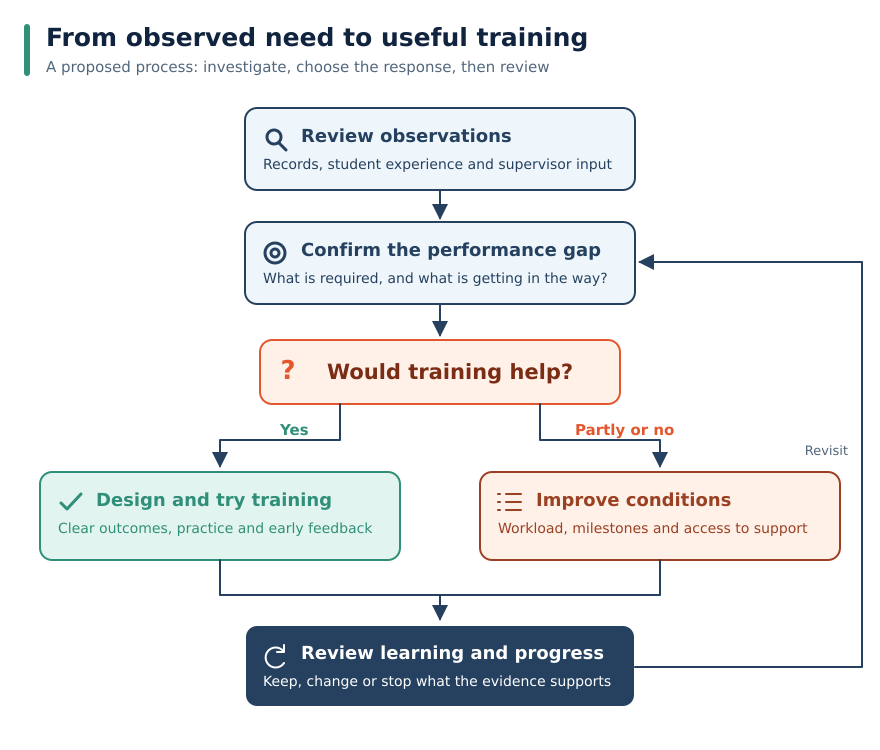
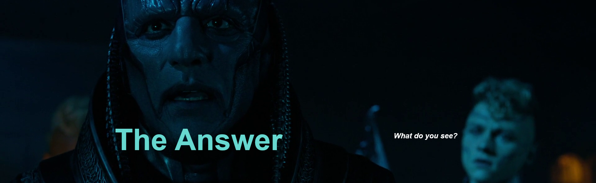
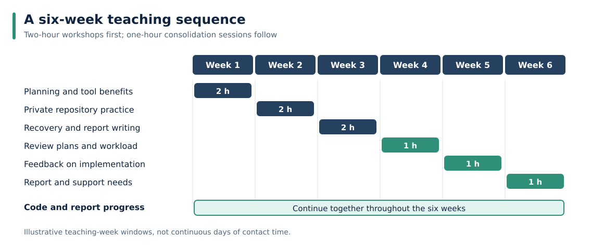
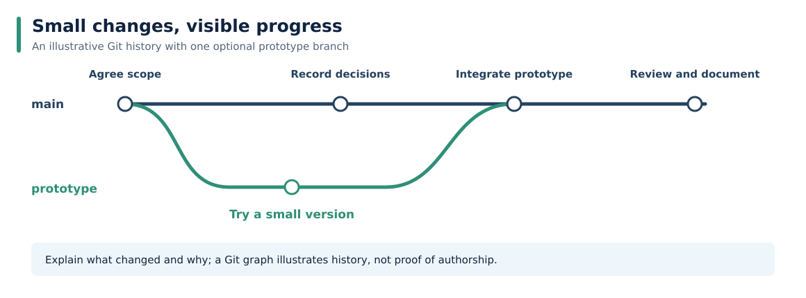
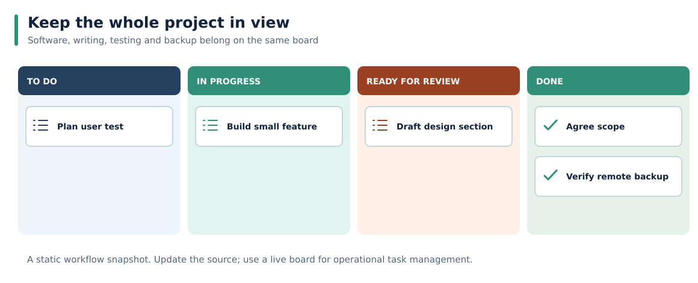

# Improving Final Year Projects: A Training Needs Analysis and Training Design

<link rel="stylesheet" href="tnid-report.css">

<!-- title-page:start -->

**Limerick and Clare Education and Training Board (LCETB)**  
**Training Needs Identification and Design (6N3325) | QQI Level 6**  
**Project: Training Needs Analysis and Training Design**  
**Author:** Mark Crowe  
**Assessor:** Caroline Nijs  
**Date:** November 2026

<!-- title-page:end -->

> **Review draft.** Retrospective observations are the author's account; supporting extracts have not yet been selected. The questionnaire, interviews and evaluation are proposed, not completed. Submission checks are listed under [Completion and evidence checks](#appendix-e).

<!-- toc:start -->

<a id="contents"></a>

## Contents

- [Chapter 1. Training Needs Analysis — Section A](#section-1)
- [Chapter 2. Evaluation of Instructional Design Models — Section B](#section-2)
- [Chapter 3. Design of the Training Intervention — Section C](#section-3)
- [Chapter 4. Conclusion](#conclusion)
- [Chapter 5. Further Development](#further-development)
- [Table of Figures](#table-of-figures)
- [Table of Tables](#table-of-tables)
- [References](#references)
- [Appendix](#appendix)
  - [Retrospective observations and evidence register](#appendix-a)
  - [Research instruments](#appendix-b)
  - [Training resources](#appendix-c)
  - [Evaluation instruments](#appendix-d)
  - [Completion and evidence checks](#appendix-e)
- [AI use and declaration](#ai-declaration)

<!-- toc:end -->

<!-- lof:start -->

<a id="table-of-figures"></a>

## Table of Figures

1. [TNA decision and review cycle](#figure-1)
2. [Six-week training schedule](#figure-2)
3. [Illustrative Git history](#figure-3)
4. [Kanban workflow](#figure-4)

<!-- lof:end -->

<!-- lot:start -->

<a id="table-of-tables"></a>

## Table of Tables

1. [Needs, evidence and priorities](#table-1)
2. [Action plan](#table-2)
3. [Comparison of design models](#table-3)
4. [Training plan](#table-4)
5. [Lesson 1](#table-5)
6. [Lesson 2](#table-6)
7. [Evaluation plan](#table-7)

<!-- lot:end -->

<a id="section-1"></a>

## Chapter 1. Training Needs Analysis (Section A)

::: {.chapter-quote}
> “Insufficient facts always invite danger.”  
> — Spock, *Star Trek*, “Space Seed” (1967)
:::

### 1.1. Introduction and rationale

This project concerns fourth-year computing students completing individual final year projects (FYPs) in an anonymised Irish college. Each FYP combines practical work and a report, supported by a module and supervisor. The author provided voluntary extra support across year groups through individual tutoring, groups, workshops and templates, sometimes seeing learners in successive years. This was a support role, not formal FYP supervision.

Students often choose topics they care about, making the FYP engaging but demanding. Recurring difficulties concerned scope, lost work, uneven progress and late reporting. A Training Needs Analysis (TNA) investigates the difference between current and required performance before deciding whether training is appropriate (LCETB, 2026a) <a id="cite-1-1"></a>[[1]](#ref-1). The starting point is therefore a performance question, rather than a preselected training package.

For students, the intended benefits are manageable work, confidence, useful feedback and a portfolio. For the institution, better projects, student experience and retention could justify the staffing investment. Research contributions, reputation and recruitment are possible longer-term benefits, not outcomes this small intervention can promise. The TNA asks which difficulties reflect knowledge or skills, which require organisational change, and what evidence would justify a training response.

### 1.2. Design of the TNA

The main method is retrospective expert observation, organised into the [Retrospective observations](#appendix-a). The author recalls repeated support encounters and decisions made in response to difficulties. These records are not contemporaneous field notes. Observation is a primary source of evidence in the course materials (LCETB, 2026a) <a id="cite-1-2"></a>[[1]](#ref-1).

Workshop materials, lecture notes, project versions, logs and commits are reported available; suitable extracts have not yet been selected or analysed for this report. Repeat voluntary attendance provides context about engagement and perceived usefulness, without establishing a causal effect on grades. Messages of thanks are not relied on. The module's actual learning outcomes and marking criteria also remain to be obtained.

A questionnaire and supervisor interview guide are designed but not issued ([Research instruments](#appendix-b)). Their future purpose is to challenge the observations and establish whether the proposed training suits the department. Designed instruments are not presented as collected results.

Recall, observer bias and selective contact with students seeking help limit the findings. Neither frequency nor population-wide prevalence is established. Positive examples are retained alongside difficulties. No college, student or staff member is identified. Any later repository extracts require appropriate access and removal of identifying details; the questionnaire is voluntary and collects no names or student numbers (European Union, 2016) <a id="cite-2-1"></a>[[2]](#ref-2).

### 1.3. Evidence of research and data collection

The [observation register](#resource-a1) uses OB for Mark’s observations. It records recalled patterns: lost work ([OB01](#observation-ob01)), excessive scope ([OB02](#observation-ob02)), late reports ([OB03](#observation-ob03)), bursts before meetings ([OB04](#observation-ob04)), insufficient attention to test-user data ([OB05](#observation-ob05)), and successful early prototypes with regular Git use ([OB06](#observation-ob06)).

Two further examples support positive development and sustainable workload. One student improved research software and contributed changes to the repository referenced by a paper ([OB07](#observation-ob07)). Another capable student neglected other activities and withdrew for approximately two years ([OB08](#observation-ob08)). This is the author's description of burnout, not a clinical diagnosis. A substantial report with little matching software also illustrates unbalanced progress ([OB09](#observation-ob09)).

The evidence register distinguishes reported materials from included records. No frequencies, grade gains, survey findings or completed module-document analysis are claimed. Designed instruments are not collected results. Supporting extracts remain to be selected and anonymised. These observation records are the primary qualitative evidence for the TNA and inform the proposed training. The designed questionnaire and interviews show how further evidence would be gathered; they are not required to be presented as completed research. This follows the assessor's classroom guidance as recalled by the author. The limitations concern recall and generalisation, not whether observation counts as evidence.

### 1.4. Analysis of research and data

The analysis maps observations to proposed project habits; the local marking criteria must be checked before treating these as verified assessment standards.

<!-- keep-together -->

<a id="table-1"></a>

**Table 1. Needs, evidence and priorities.**

| Need                                   | Evidence                          | Type              | Priority and response                                          |
|----------------------------------------|-----------------------------------|-------------------|----------------------------------------------------------------|
| Protect and recover work               | [OB01](#observation-ob01), [OB06](#observation-ob06)                            | Skill             | High: practical Git and recovery workshops                     |
| Manage scope, priorities and deadlines | [OB02](#observation-ob02), [OB04](#observation-ob04)                            | Skill/performance | High: planning practice and agreed milestones                  |
| Develop software and report together   | [OB03](#observation-ob03); [OB09](#observation-ob09)          | Performance       | High: logs, draft sections and regular review                  |
| Recognise data and AI requirements     | [OB05](#observation-ob05)                                | Knowledge         | Medium: guidance and a supervisor-reviewed checklist           |
| Sustain workload and confidence        | [OB08](#observation-ob08)                                | Development       | High: manageable plans and support                             |
| Collaborate and extend skills          | [OB06](#observation-ob06), [OB07](#observation-ob07)                            | Development       | Differentiated opportunities, including optional contributions |

Priorities reflect the potential impact of failure and the feasibility of support, not measured frequencies. Programming ability alone does not establish competence in planning, recovery or research-data handling.

Training cannot solve every issue. Bursts of work may reflect unclear milestones, competing modules, workload or supervision arrangements. The module leader must review these conditions rather than assume motivation is the problem. Similarly, writing and software require balanced progress: exact grade weightings and any minimum component requirements remain unverified.

Different starting points call for differentiated support. Some learners need guided practice; others need challenge or help setting limits. Additional work is optional, and no fixed top/bottom percentage is assumed.

The distinction between inability and difficulty applying a skill matters. A learner may understand version control but avoid it after a confusing experience; another may never have practised it. Both can struggle, but the first needs a simpler, credible workflow and the second needs instruction and rehearsal. The proposed initial practical check and interviews would help distinguish these situations.

Similarly, repeat attendance is valuable context because support involved additional voluntary hours. It suggests learners perceived a benefit, but return visits could also reflect continuing difficulty, assessment pressure or a preference for individual help. These possibilities should be considered rather than turning positive feedback into a claim of measured improvement. The TNA therefore combines the author's experience with a plan for testing assumptions before committing the department to a standard programme.

<a id="figure-1"></a>

<!-- mermaid src="diagrams/needs.mmd" image-src="assets/print/needs.png" alt="TNA decision and review cycle with colour-coded actions and icons" -->



<!-- /mermaid -->

[Editable Mermaid source](diagrams/needs.mmd)

*Figure 1. Proposed TNA decision and review cycle. Source: author's design. Training and organisational responses may both be needed.* [Contents](#contents)

### 1.5. Action plan and recommendations

<a id="table-2"></a>

**Table 2. Action plan.**

| Action                                                          | Responsibility            | Timing                                  | Intended outcome                 |
|-----------------------------------------------------------------|---------------------------|-----------------------------------------|----------------------------------|
| Review existing evidence; issue questionnaire/interview guide   | Trainer and module leader | Before rollout                          | Confirm or revise needs          |
| Check supervisors' tool skills and provide targeted preparation | Module leader             | Two to three weeks before each semester | Effective student support        |
| Deliver workshops and consolidation                             | Designated trainer        | Weeks 1–6 each semester                 | Practical project habits         |
| Agree project/report milestones and drop-in allocation          | Module leader             | Before delivery                         | Sustained, accessible support    |
| Review application and outcomes                                 | Trainer and supervisors   | Week 8, semester end and submission     | Revise training through feedback |

One appropriately skilled trainer is the minimum proposed resource. Delivery requires 18 scheduled hours annually per teaching group, plus preparation, setup, administration, support and evaluation. Funding and timetable capacity require agreement. Longer term, these skills could begin in first- or second-year projects, with final-year training becoming a refresher.

<a id="section-2"></a>

## Chapter 2. Evaluation of Instructional Design Models (Section B)

### 2.1. Explanation of two models

**SAM (Successive Approximation Model)** develops training through Preparation, Iterative Design and Iterative Development: gather information, review early prototypes and improve materials through repeated testing (LCETB, 2026c) <a id="cite-4-1"></a>[[4]](#ref-4). Here, student try-outs expose practical difficulties before wider delivery.

**Backward Design** begins with desired outcomes, identifies acceptable evidence, then plans learning activities (LCETB, 2026d) <a id="cite-5-1"></a>[[5]](#ref-5). If students must recover work, assessment requires demonstrating recovery; teaching supplies the practice needed. It suits clear performance goals.

### 2.2. Comparison of models

<a id="table-3"></a>

**Table 3. Comparison of design models.**

| Consideration    | SAM                                          | Backward Design                                                           |
|------------------|----------------------------------------------|---------------------------------------------------------------------------|
| Emphasis         | Iterative development through feedback       | Alignment of outcomes, evidence and activities                            |
| Strength         | Early testing reveals practical problems     | Keeps assessment relevant and content focused                             |
| Limitation       | Iteration consumes time and can expand scope | Poorly chosen outcomes can narrow learning; no prescribed prototype cycle |
| Suitable context | Needs or materials still require testing     | Clear performance goals and assessment requirements                       |
| Application      | Improve practical workshops                  | Define successful planning, recovery and reporting                        |

They complement rather than replace one another. SAM tests assumptions; Backward Design asks what each activity contributes. Neither guarantees good training. The designer must balance feedback, available time and evidence of worthwhile learning.

The models address different design risks. A workshop built around available software may teach commands without showing why they matter. Backward Design instead starts with a real performance requirement: for example, protecting work and explaining decisions. A completed repository is insufficient evidence if the student cannot explain the changes or recover a simple error. Activities should prepare learners for that demonstration, rather than reward attendance alone.

SAM is useful where the initial needs analysis is incomplete. A small try-out can reveal whether instructions are clear, prerequisites are missing or the exercise adds avoidable effort. However, frequent changes require versioned materials and a record of why revisions were made. The trainer must distinguish changes supported by feedback from attractive additions that exceed the agreed time.

Combining the models does not mean prescribing every outcome permanently. If student and supervisor feedback indicates that an outcome is unrealistic or irrelevant, the trainer revisits it. Backward Design then realigns assessment and practice, while SAM supplies the review cycle. The module leader retains responsibility for agreeing changes that affect the wider module.

### 2.3. Justification of chosen model

**SAM guides the overall design, with Backward Design within its cycles.** Needs remain provisional, so early student feedback should revise unclear or burdensome exercises. The module leader checks fit; supervisors' project observations inform improvements. These reviews are proposed, not completed.

The author's Agile experience informs their preference for iteration. The waterfall analogy is approximate: ADDIE also permits prototypes, pilots and revision (LCETB, 2026b) <a id="cite-3-1"></a>[[3]](#ref-3). Selecting SAM does not depend on claiming ADDIE cannot change.

Backward Design keeps cycles purposeful: specify performance, choose evidence, then design practice. Feedback can revise activities, assessment or outcomes. This retains one lead model while using both models' strengths.

<a id="section-3"></a>

## Chapter 3. Design of the Training Intervention (Section C)

::: {.chapter-quote}
> “Why do we fall, Bruce? So we can learn to pick ourselves up.”  
> — Thomas Wayne, *Batman Begins* (2005)
:::

### 3.1. Programme overview

**Title:** Planning, Protecting and Completing Your Final Year Project.

**Audience and aim:** fourth-year computing students, provisionally in groups of about 20, learning to manage an FYP sustainably and apply useful habits across their studies.

**Learning outcomes:** students will be able to:

1. Define manageable scope, prioritised next actions and milestones.
2. Use a private repository to commit, push and explain meaningful changes.
3. Resolve a prepared file conflict with guidance and protect work before recovery.
4. Maintain a project log and develop report sections alongside implementation.
5. Identify data/AI questions requiring approved guidance before proceeding.
6. Review overall workload and communicate a clear project summary.

**Delivery:** two 13-week semesters, each with two-hour workshops in weeks 1–3 and one-hour consolidation in weeks 4–6: nine hours per semester, 18 annually per group. Existing FYP orientation remains separate. Semester 2 content responds to project needs. Drop-in timing requires a staffing allocation. Computer-lab delivery combines demonstrations, questions, supported practice and accessible online resources.

Planning begins with one overview of FYP work, other modules, employment and personal commitments. Students identify next actions, use a simple Kanban board, sketch milestones/dependencies in a Gantt chart and review priorities weekly. David Allen's Getting Things Done offers a supporting approach to capturing, organising and reviewing commitments (David Allen Company, n.d.) <a id="cite-9-1"></a>[[9]](#ref-9). AI may accelerate separate tasks while leaving the student as the coordination bottleneck; an optional overall assistant can support the overview, but the student retains direction. The aim is progress across all required modules, not excellence in one while another is overlooked.

Sustainable workload is a guiding principle supported by the author's observations. Maslow's account of needs provides a way to consider basic needs and relationships alongside achievement (Maslow, 1943) <a id="cite-10-1"></a>[[10]](#ref-10). Plans reserve room for rest and other interests. Initial practical checks identify support needs; advanced learners may choose peer feedback or contribution opportunities. Student-owned repositories support authorised supervisor feedback and later portfolios where sharing is permitted. Process support can span disciplines; specialist academic judgement remains with the subject supervisor.

### 3.2. Training plan

<a id="table-4"></a>

**Table 4. Training plan.**

| Timing                                  | Focus and methods                                                                | Evidence                                   |
|-----------------------------------------|----------------------------------------------------------------------------------|--------------------------------------------|
| Semester 1, week 1: 2 hours             | Planning, tool benefits, concise project summaries, scope and workload           | Initial board and milestone plan           |
| Week 2: 2 hours                         | Guided private-repository workflow, commits, push, history and supervisor access | Pushed change explained; log entry         |
| Week 3: 2 hours                         | Safe recovery, prepared WinMerge conflict, writing from actual work, checklist   | Resolved practice conflict; report passage |
| Weeks 4–6: 1 hour weekly, each semester | Consolidation, questions and feedback on current work                            | Revised plans and report sections          |
| Semester 2, weeks 1–3: 2 hours weekly   | Needs-led workshops on testing, recovery, collaboration and completion           | Demonstrations linked to current needs     |
| Drop-ins and supervisor reviews         | Help across the ability range; workload and progress checks                      | Support themes and week 8 checklist        |

SAM uses early try-outs and feedback to revise materials; Backward Design links the outcomes to the evidence above. Gagné supplies a supporting workshop structure (LCETB, 2026e) <a id="cite-6-1"></a>[[6]](#ref-6). Attention, outcomes and recall prepare learners for demonstration. Guided practice, feedback and assessment follow. Application to their own FYP supports transfer beyond the session.

Using learners' actual work makes the activities relevant and problem-centred (LCETB, 2026g) <a id="cite-7-1"></a>[[7]](#ref-7). Preparation includes software/access checks and supervisor support two to three weeks before each semester.

### 3.3. Two detailed lesson plans

#### Lesson 1: Planning and tool benefits (120 minutes)

**Outcomes:** define scope, prioritise tasks, sketch milestones and explain a tool's benefit.

<a id="table-5"></a>

**Table 5. Lesson 1.**

| Minutes | Trainer                                           | Learner                               | Resource        | Assessment        |
|---------|---------------------------------------------------|---------------------------------------|-----------------|-------------------|
| 0–15    | Explain outcomes; tell difficulty/success stories | Identify risks and helpful habits     | [TR09](#resource-c9); slides      | Discussion        |
| 15–35   | Demonstrate scope and Kanban                      | Prioritise example tasks              | [TR01](#resource-c1), [TR07](#resource-c7)          | Explain choices   |
| 35–55   | Guide individual planning                         | Define scope and board                | [TR01](#resource-c1), [TR07](#resource-c7)          | Scope check       |
| 55–65   | Break                                             | Break                                 | —               | —                 |
| 65–85   | Demonstrate milestones/dependencies               | Sketch balanced deadlines             | [TR06](#resource-c6), [TR07](#resource-c7), [TR11](#resource-c11)     | Feasibility check |
| 85–100  | Demonstrate Git benefits                          | Ask questions                         | Demo repository | Explain benefit   |
| 100–115 | Support peer review                               | Revise plan and 140-character summary | [TR06](#resource-c6), [TR10](#resource-c10)         | Feedback          |
| 115–120 | Summarise                                         | Give next action/question             | Exit ticket     | Next action       |

#### Lesson 2: Private repositories and meaningful progress (120 minutes)

**Outcomes:** commit and push changes, explain history, arrange supervisor access and log progress.

<a id="table-6"></a>

**Table 6. Lesson 2.**

| Minutes | Trainer                      | Learner                            | Resource        | Assessment           |
|---------|------------------------------|------------------------------------|-----------------|----------------------|
| 0–15    | Check prior skills           | Explain experience/progress        | Practical check | Support needs        |
| 15–35   | Demonstrate workflow         | Follow and question                | [TR02](#resource-c2); lab PCs     | Guided checks        |
| 35–55   | Support commit/push          | Create private practice repository | [TR02](#resource-c2)              | Verify remote change |
| 55–65   | Break                        | Break                              | —               | —                    |
| 65–85   | Demonstrate history review   | Make/explain second change         | Repository      | Explain differences  |
| 85–100  | Explain sharing and feedback | Check authorised access            | [TR02](#resource-c2)              | Access check         |
| 100–115 | Troubleshoot; model log      | Practise and record decisions      | [TR04](#resource-c4)              | Demonstration/log    |
| 115–120 | Collect questions            | Request support                    | [EI01](#resource-d1)              | Review next needs    |

Workshop 3 uses a disposable conflict exercise ([TR08](#resource-c8)), WinMerge, recovery practice and report drafting. Complex branching is optional; resources support trainer-led questions and practice.

::: {.chapter-quote}
> “The exocomp didn’t fail the test, it saw right through it.”  
> — Dr Beverly Crusher, *Star Trek: The Next Generation*, [“The Quality of Life”](https://tng.trekcore.com/episodes/season6/6x09/609quotes.html) (1992)
:::

A poorly matched exercise can teach students to dislike a tool and discourage them from using it again. Requiring five branches for a solo project, for example, tests whether the student can follow a recipe. The workshop should give the student a realistic task: preserve a stable version, try a risky change and recover if it goes wrong. A student may reasonably work directly on the default branch for a small, low-risk change, or use the default branch plus one working branch for an experiment. Ask the student to explain that choice and demonstrate how they would get back to a known-good version.

**Implementation and resourcing.** The designated trainer needs practical knowledge of Git and recovery tools, planning, collaboration and learner support. Supervisor tool skills are checked two to three weeks before each semester, allowing targeted preparation. A subject expert may need support using repository history even while being fully competent to assess disciplinary work.

For each teaching group, scheduled delivery totals 18 hours annually. Preparation includes practice repositories, software checks, materials, access invitations and evaluation. Drop-ins require a separate agreed allocation; their frequency is an implementation decision, not an uncosted promise. Staffing costs should distinguish delivery from preparation and support, using the institution's actual rates. Larger groups or substantial troubleshooting demand may require additional assistance.

Students preferably retain repositories on their own GitHub accounts and invite the authorised supervisor and trainer. A module-owned organisation is an alternative. Student ownership supports later employment portfolios, while public release depends on assessment rules, rights and data requirements. These administrative arrangements must be established before students are asked to share work.

The author's support experience also illustrates why feedback must be timely and specific. Watching a learner attempt an exercise can reveal the point at which their understanding breaks down, allowing a small explanation or demonstration to help them continue. Repository changes and short project explanations can support similar conversations between meetings, while direct discussion remains necessary where the history does not explain the difficulty. The purpose of tracking is therefore to improve project management and learning, not merely to count activity. Constructive feedback and visible progress can support confidence, collaboration and independent decisions.

### 3.4. Learning materials, resources and aids

The [training resources](#appendix-c) include the backlog worksheet, corrected Git workflow, data/AI checklist, project log, report frame, overall workload plan, Kanban/milestone templates and a prepared conflict exercise, concise-summary prompt and Mermaid examples. Learn Git Branching supports command practice and visualisation; it supplements teaching. WinMerge supports the guided file-conflict exercise.

Materials are used during workshops, with step-by-step support and optional extension. Practice recovery uses disposable repositories before assessed work. Students can consult resources afterwards. The trainer needs practical skills in Git, planning and collaboration, and time for preparation, invitations and follow-up. Repository access is agreed with the student; public sharing is not required for assessment.

**Visual documentation.** Students would explain plans, relationships and progress through simple diagrams alongside concise prose. Mermaid is an open-source tool that turns editable text into diagrams, including Gantt charts, Git histories and Kanban workflows (Mermaid, n.d.a–d) <a id="cite-11-1"></a>[[11]](#ref-11) <a id="cite-12-1"></a>[[12]](#ref-12) <a id="cite-13-1"></a>[[13]](#ref-13) <a id="cite-14-1"></a>[[14]](#ref-14). Keeping diagram source with project documentation makes revisions visible in Git. [TR11](#resource-c11) provides examples and the Live Editor; the lesson 1 milestone demonstration uses its Gantt example. GitHub supports Mermaid blocks in Markdown, subject to its renderer version (GitHub, n.d.) <a id="cite-15-1"></a>[[15]](#ref-15). Diagrams should clarify the student's work, with readable labels and captions, rather than replace evidence.

### 3.5. Evaluation of the training programme

Kirkpatrick's four levels distinguish satisfaction, learning, application and outcomes (LCETB, 2026f) <a id="cite-8-1"></a>[[8]](#ref-8).

<a id="table-7"></a>

**Table 7. Evaluation plan.**

| Level     | Evidence                                                                                   | Timing                  |
|-----------|--------------------------------------------------------------------------------------------|-------------------------|
| Reaction  | Relevance, confusion, burden and support requests                                          | Each session            |
| Learning  | Plans, demonstrated Git/recovery skills, logs and report passages                          | Workshops               |
| Behaviour | Meaningful repository changes, planning reviews, balanced progress and manageable workload | Supervision; week 8     |
| Results   | Project/report quality, lost-work cases, extensions and retention                          | Semester end/submission |

Students report their experience; supervisors observe application during normal weekly or fortnightly contact; the module leader reviews patterns across groups. Repository changes and explanations inform feedback, not commit counts alone. Monitoring may prompt questions about unexpected work, without making unsupported authorship claims. Optional automated reviews support human judgement.

A proposed comparison uses two classes on the same or a comparable FYP module: one receives additional training, the other usual support. Compare average grades against compatible marking criteria, considering prior performance, baseline habits, effect size and uncertainty. With one class per condition, teaching, supervision and other class differences remain possible explanations. This is a proposed evaluation, not collected data or proof of causation.

The test is whether training helps. Unnecessary branching could make small projects harder and discourage tool use; feedback should trigger simpler exercises or more guidance. Evaluate benefits across starting points and workload levels, not just the mean. Collaboration, constructive peer feedback and optional research-software contributions are positive outcomes.

Institutional benefits may include better student feedback, retention and project quality. Recruitment, reputation, research and competitiveness are longer-term possibilities requiring separate evidence. Review benefits alongside actual staffing costs. Evaluation findings revise the next version through SAM.

Before rollout, the module leader should agree who records each indicator, how comparable marking will be achieved and what would justify revising or stopping an activity. A baseline practical task should be repeated after training using comparable difficulty. Changes in demonstrated ability offer more direct learning evidence than satisfaction alone. Student explanations and supervisor feedback help interpret progress, while reports of overload or discouragement identify unintended effects. Annual review considers the resources consumed as well as the benefits.

<a id="conclusion"></a>

## Chapter 4. Conclusion

The author's tutoring experience identifies recurring difficulties in managing final-year projects: excessive scope, lost work, uneven progress and an imbalance between software and reporting. Positive examples also show the value of early feedback, collaboration and opportunities to contribute beyond the classroom. These observations provide a practical starting point for the TNA, while their retrospective and selective nature limits claims about prevalence. Existing materials and project histories, followed by the proposed questionnaire and interviews, would help confirm which needs apply to the department.

The proposed intervention responds through planning, practical tool workshops and continuing support, rather than simply giving students resources to read. SAM provides a cycle for testing and improving the training; Backward Design keeps outcomes, evidence and learning activities aligned. Supervisor preparation, student-owned repositories and an overall workload plan connect the sessions to everyday project work. Differentiated support includes both additional guidance and appropriate challenge, while sustainable workload and life outside study remain part of successful completion.

The programme requires staff time and institutional commitment. Its value would be judged through demonstrated skills, application during the FYP, student and supervisor feedback, and project outcomes considered alongside costs. The proposed class comparison could inform that judgement without isolating training from every other influence. The recommendation is therefore to confirm the needs, agree resources and pilot the intervention, using evidence to decide what to retain or change. Improved retention, research contribution and institutional reputation remain intended longer-term benefits rather than findings already established.

<a id="further-development"></a>

## Chapter 5. Further Development

Introduce planning, version control and clear documentation through smaller first- and second-year projects, reinforcing them as assignments become more complex. Final-year induction could then consolidate established habits rather than introduce every skill at once. Adaptation to other disciplines should begin with their own needs analysis and supervisor preparation. Later development could examine optional AI-assisted workload coordination and expand the evaluation across cohorts, provided these additions remain useful, manageable and supported by evidence.

---

<a id="references"></a>

## References

An arrow marks a link that leaves the report. The source link opens the online original. The red-padlock Markdown icon links to a copy kept in the private repository for future reference if the online source changes or disappears. The building icon opens the Wayback Machine calendar for public web sources. Capture availability varies.

1. <a id="ref-1"></a> LCETB (2026a) *Part A: The TNA recap*. Training Needs Identification and Design (6N3325) [Lecture slides]. Limerick and Clare Education and Training Board. [ Markdown course notes](https://github.com/SDevTutors/train-the-trainer-2026/blob/master/md/050-part-a-the-tna-recap.md) (Accessed: 18 November 2026). [Back to text](#cite-1-1). [](<../my-fetches/course/050-part-a-the-tna-recap.md>).

2. <a id="ref-2"></a> European Union (2016) *Regulation (EU) 2016/679 (General Data Protection Regulation)*. Official Journal of the European Union, L 119, pp. 1–88. Available at: [eur-lex.europa.eu](<https://eur-lex.europa.eu/eli/reg/2016/679/oj>) (Accessed: 17 November 2026). [Back to text](#cite-2-1). [](<../my-fetches/pages/gdpr-2016-679.md>). [](<https://web.archive.org/web/*/https://eur-lex.europa.eu/eli/reg/2016/679/oj>)

3. <a id="ref-3"></a> LCETB (2026b) *ADDIE*. Training Needs Identification and Design (6N3325) [Lecture slides]. Limerick and Clare Education and Training Board. [ Markdown course notes](https://github.com/SDevTutors/train-the-trainer-2026/blob/master/md/040-addie-1.md) (Accessed: 18 November 2026). [Back to text](#cite-3-1). [](<../my-fetches/course/040-addie-1.md>).

4. <a id="ref-4"></a> LCETB (2026c) *The SAM Model of Instructional Design*. Training Needs Identification and Design (6N3325) [Lecture slides]. Limerick and Clare Education and Training Board. [ Markdown course notes](https://github.com/SDevTutors/train-the-trainer-2026/blob/master/md/046-the-sam-model-of-instructional-design.md) (Accessed: 18 November 2026). [Back to text](#cite-4-1). [](<../my-fetches/course/046-the-sam-model-of-instructional-design.md>).

5. <a id="ref-5"></a> LCETB (2026d) *Backward Design*. Training Needs Identification and Design (6N3325) [Lecture slides]. Limerick and Clare Education and Training Board. [ Markdown course notes](https://github.com/SDevTutors/train-the-trainer-2026/blob/master/md/045-backward-design.md) (Accessed: 18 November 2026). [Back to text](#cite-5-1). [](<../my-fetches/course/045-backward-design.md>).

6. <a id="ref-6"></a> LCETB (2026e) *Part B: Instructional design models recap*. Training Needs Identification and Design (6N3325) [Lecture slides]. Limerick and Clare Education and Training Board. [ Markdown course notes](https://github.com/SDevTutors/train-the-trainer-2026/blob/master/md/051-part-b-instructional-design-models-recap.md) (Accessed: 18 November 2026). [Back to text](#cite-6-1). [](<../my-fetches/course/051-part-b-instructional-design-models-recap.md>).

7. <a id="ref-7"></a> LCETB (2026g) *Adult Learning Theory*. Training Needs Identification and Design (6N3325) [Lecture notes]. Limerick and Clare Education and Training Board. Available at: [ github.com](<https://github.com/SDevTutors/train-the-trainer-2026/blob/master/md/020-adult-learning-theory.md>) (Accessed: 18 November 2026). [Back to text](#cite-7-1). [](<../my-fetches/course/020-adult-learning-theory.md>).

8. <a id="ref-8"></a> LCETB (2026f) *Part C: Training intervention recap*. Training Needs Identification and Design (6N3325) [Lecture slides]. Limerick and Clare Education and Training Board. [ Markdown course notes](https://github.com/SDevTutors/train-the-trainer-2026/blob/master/md/052-part-c-training-intervention-recap.md) (Accessed: 18 November 2026). [Back to text](#cite-8-1). [](<../my-fetches/course/052-part-c-training-intervention-recap.md>).

9. <a id="ref-9"></a> David Allen Company (n.d.) *What is GTD?* Available at: [gettingthingsdone.com](<https://gettingthingsdone.com/what-is-gtd/>) (Accessed: 18 November 2026). [Back to text](#cite-9-1). [](<../my-fetches/pages/gtd-overview.md>). [](<https://web.archive.org/web/*/https://gettingthingsdone.com/what-is-gtd/>)

10. <a id="ref-10"></a> Maslow, A.H. (1943) 'A theory of human motivation', *Psychological Review*, 50(4), pp. 370–396. Available at: [psychclassics.yorku.ca](<https://psychclassics.yorku.ca/Maslow/motivation.htm>) (Accessed: 18 November 2026). [Back to text](#cite-10-1). [](<../my-fetches/pages/maslow-1943.md>). [](<https://web.archive.org/web/*/https://psychclassics.yorku.ca/Maslow/motivation.htm>)

11. <a id="ref-11"></a> Mermaid (n.d.a) *About Mermaid*. Available at: [ mermaid.js.org](<https://mermaid.js.org/intro/>) (Accessed: 18 November 2026). [Back to text](#cite-11-1). [](<../my-fetches/pages/mermaid-introduction.md>). [](<https://web.archive.org/web/*/https://mermaid.js.org/intro/>)

12. <a id="ref-12"></a> Mermaid (n.d.b) *Gantt diagrams*. Available at: [ mermaid.js.org](<https://mermaid.js.org/syntax/gantt.html>) (Accessed: 18 November 2026). [Back to text](#cite-12-1). [](<../my-fetches/pages/mermaid-gantt.md>). [](<https://web.archive.org/web/*/https://mermaid.js.org/syntax/gantt.html>)

13. <a id="ref-13"></a> Mermaid (n.d.c) *GitGraph diagrams*. Available at: [ mermaid.js.org](<https://mermaid.js.org/syntax/gitgraph.html>) (Accessed: 18 November 2026). [Back to text](#cite-13-1). [](<../my-fetches/pages/mermaid-gitgraph.md>). [](<https://web.archive.org/web/*/https://mermaid.js.org/syntax/gitgraph.html>)

14. <a id="ref-14"></a> Mermaid (n.d.d) *Kanban diagram documentation*. Available at: [ mermaid.js.org](<https://mermaid.js.org/syntax/kanban.html>) (Accessed: 18 November 2026). [Back to text](#cite-14-1). [](<../my-fetches/pages/mermaid-kanban.md>). [](<https://web.archive.org/web/*/https://mermaid.js.org/syntax/kanban.html>)

15. <a id="ref-15"></a> GitHub (n.d.) *Creating diagrams*. Available at: [docs.github.com](<https://docs.github.com/en/get-started/writing-on-github/working-with-advanced-formatting/creating-diagrams>) (Accessed: 18 November 2026). [Back to text](#cite-15-1). [](<../my-fetches/pages/github-diagrams.md>). [](<https://web.archive.org/web/*/https://docs.github.com/en/get-started/writing-on-github/working-with-advanced-formatting/creating-diagrams>)

16. <a id="ref-16"></a> Git (n.d.) *Git reference manual*. Available at: [git-scm.com](<https://git-scm.com/docs>) (Accessed: 18 November 2026). [Back to text](#cite-16-1). [](<../my-fetches/pages/git-reference.md>). [](<https://web.archive.org/web/*/https://git-scm.com/docs>)

17. <a id="ref-17"></a> WinMerge (n.d.) *Comparing and merging text files*. Available at: [manual.winmerge.org](<https://manual.winmerge.org/en/Compare_files.html>) (Accessed: 18 November 2026). [Back to text](#cite-17-1). [](<../my-fetches/pages/winmerge-file-comparison.md>). [](<https://web.archive.org/web/*/https://manual.winmerge.org/en/Compare_files.html>)

18. <a id="ref-18"></a> Learn Git Branching (n.d.) *Learn Git Branching*. Available at: [learngitbranching.js.org](<https://learngitbranching.js.org/>) (Accessed: 18 November 2026). [Back to text](#cite-18-1). [](<../my-fetches/pages/learn-git-branching.md>). [](<https://web.archive.org/web/*/https://learngitbranching.js.org/>)

---

<a id="appendix"></a>

## Appendix

<a id="appendix-a"></a>

### Retrospective observation records

<a id="resource-a1"></a>

#### Recalled examples

Prepared from the author's account during planning, not contemporaneous field notes. Calendar dates, counts and case files are not supplied. These summaries record what is recalled without inventing subsequent outcomes. **OB** means Mark’s observations.

| ID | Recollection                                                              | Interpretation and limitation                                      |
|----|---------------------------------------------------------------------------|--------------------------------------------------------------------|
| <a id="observation-ob01"></a>OB01 | Students lost work without a usable backup/history                        | Practice in remote backup and recovery could address the risk      |
| <a id="observation-ob02"></a>OB02 | Project scope exceeded available time                                     | Scope and milestone planning need attention                        |
| <a id="observation-ob03"></a>OB03 | Reports were left until the final weeks                                   | Writing alongside implementation may help                          |
| <a id="observation-ob04"></a>OB04 | Work occurred in bursts before meetings                                   | Explore workload, milestones and supervision as well as skills     |
| <a id="observation-ob05"></a>OB05 | Test-user data requirements were considered late                          | Need for early approved guidance, not a finding of legal liability |
| <a id="observation-ob06"></a>OB06 | Early versions and Git use accompanied successful progress                | Positive association recalled; causal effect not established       |
| <a id="observation-ob07"></a>OB07 | Student corrected research software and contributed to its repository     | Collaboration and visible contribution; not paper co-authorship    |
| <a id="observation-ob08"></a>OB08 | Capable student reduced other activities and withdrew for about two years | Illustrates workload concerns; no diagnosis or causal finding      |
| <a id="observation-ob09"></a>OB09 | Substantial report accompanied very little matching software              | Supports balanced software/report development                      |

**Local standard:** actual module outcomes and marking criteria remain to be supplied and checked. No numerical grade weighting is asserted.

<a id="resource-a2"></a>

#### Supporting evidence register

| Material                                        | What it could support                                     | Status                                                                                 |
|-------------------------------------------------|-----------------------------------------------------------|----------------------------------------------------------------------------------------|
| Tutor workshop materials and lecture notes      | Topics and forms of support previously offered            | Reported available; select an anonymised example                                       |
| Project logs, staged versions and Git histories | Worked examples of difficulties, feedback and improvement | Reported available; confirm permission and remove identifying details before inclusion |
| Voluntary attendance records, if retained       | Participation and repeat engagement in extra support      | Counts not supplied; do not invent figures or infer causal effects on grades           |
| Feedback and messages of thanks                 | Perceived usefulness of support                           | Not relied on; retrieval may be difficult or messages may have expired                 |
| Module outcomes and marking criteria            | Required local performance and assessment standards       | Not supplied; verify before making claims about grade weights                          |

Retrospective observations are the evidence currently documented in this draft. The existence of possible corroborating records does not mean that their contents have already been analysed. Repeated voluntary attendance is consistent with learners finding support useful, while selection effects and other reasons for returning remain possible.

<a id="appendix-b"></a>

### Research instruments

<a id="resource-b1"></a>

#### Student questionnaire

Designed, not issued. Voluntary; no names/student numbers; not linked to grades. Do not name people, projects or the institution in free text. Explain purpose, access and retention before issue; blank or identifying responses require careful handling. Participation statement: "I agree that my anonymised answers may be used to improve the project module." Yes / No.

1. Which stage of your project are you at? Proposal / building / testing / writing up.
2. Describe one part of the project you had to manage on your own. What did doing it well require?
3. Which part has been hardest, if any? Give an example without naming anyone.
4. How do you back up your project? Not at all / copies on my laptop / cloud folder / Git with a remote repository / other.
5. When did you start, or plan to start, writing your report? From the start / middle / last month / last two weeks.
6. What made it difficult? Tick any: unfamiliar concepts / too little practice / unclear expectations / software or access problems / time / unsure / no difficulty.
7. Which support would help most? Tick up to two: a worked example / hands-on practice / clearer milestones / feedback on an early version / a checklist / none needed.
8. Could you now manage a comparable project on your own? Yes / partly / no / not tried yet. What support, if any, would you need?

<a id="resource-b2"></a>

#### Supervisor interview guide

Fifteen minutes; notes taken with permission; no student is named.

1. What should a final-year student be able to do on their own by the end of the project?
2. Which difficulties recur across year groups?
3. What do students who finish well do differently?
4. Which of these could training address, and which need a change in the module?
5. What would show you that a training session had made a difference? Which tool skills or resources would you need to support students?

<a id="appendix-c"></a>

### Training resources

**TR** means training resource.

| ID | Training resource |
| --- | --- |
| [TR01](#resource-c1) | [Backlog worksheet](#resource-c1) |
| [TR02](#resource-c2) | [Git quick reference](#resource-c2) |
| [TR03](#resource-c3) | [Data protection and AI checklist](#resource-c3) |
| [TR04](#resource-c4) | [Project log template](#resource-c4) |
| [TR05](#resource-c5) | [Report section frame](#resource-c5) |
| [TR06](#resource-c6) | [Overall workload and weekly review](#resource-c6) |
| [TR07](#resource-c7) | [Kanban board and milestone sketch](#resource-c7) |
| [TR08](#resource-c8) | [Prepared conflict and recovery exercise](#resource-c8) |
| [TR09](#resource-c9) | [Opening story prompts](#resource-c9) |
| [TR10](#resource-c10) | [Concise communication exercise](#resource-c10) |
| [TR11](#resource-c11) | [Visual documentation with Mermaid](#resource-c11) |

<a id="resource-c1"></a>

#### TR01. Backlog worksheet

| Feature | Priority (must / should / could) | Estimate (days) | In minimum viable product? |
|---------|----------------------------------|-----------------|----------------------------|
|         |                                  |                 |                            |

Agree the smallest coherent set of essential features; review its feasibility with the supervisor. Estimates and scope can change as work is tested.

<a id="resource-c2"></a>

#### TR02. Git quick reference

Use a disposable practice folder and an empty **private** GitHub repository. Install Git, configure your name/email and authenticate before the workshop. Check which email will appear in commits. Add a suitable .gitignore before staging; exclude credentials, personal data and generated files.

```bash
# Create a local repository and inspect the intended changes.
git init -b main
git status
git add readme.md
git diff --staged

# Record the change, then connect to your empty private repository.
git commit -m "Describe the project aim"
git remote add origin "YOUR_EMPTY_PRIVATE_REPOSITORY_URL"

# Push the first commit and inspect the local history.
git push -u origin main
git log --oneline
```

Create readme.md before adding it. Replace YOUR_EMPTY_PRIVATE_REPOSITORY_URL with the actual URL. Check the remote copy in GitHub and grant the agreed supervisor access. For subsequent changes, inspect status and differences, stage intended files, commit and push. Commit meaningful progress and push regularly. A local commit alone is not a remote backup. If using an existing repository, clone it rather than running this new-repository setup again. Ask for help before destructive recovery commands.

Source: Git (n.d.) <a id="cite-16-1"></a>[[16]](#ref-16), [Git documentation](https://git-scm.com/docs).
<a id="resource-c3"></a>

#### TR03. Data protection and AI checklist

- Have I checked module guidance and any required ethics approval before involving test users?
- Will I collect personal data? If yes, ask the supervisor to confirm the applicable lawful basis, participant information, permissions and retention arrangements before collection.
- Collect only necessary data; agree secure storage, authorised access and deletion. Keep personal data out of public repositories.
- Check the institution's AI rules whether or not test-user data is involved. Record permitted use and verify outputs.
- Do not upload other people's data or restricted project content to AI services without appropriate authorisation.

This checklist prompts approved guidance; it is not an ethics approval or a substitute for institutional procedures.

<a id="resource-c4"></a>

#### TR04. Project log template

| Date | Sprint | Done | Cut or deferred | Problems | Decisions and why |
|------|--------|------|-----------------|----------|-------------------|
|      |        |      |                 |          |                   |

<a id="resource-c5"></a>

#### TR05. Report section frame

1. **Goal of this sprint:** what was planned.
2. **What was built:** with a screenshot or diagram.
3. **Decisions:** the options considered, the one chosen and why.
4. **Testing:** how it was checked.
5. **What changed:** what was cut or moved to a later sprint, and why.

<a id="resource-c6"></a>

#### TR06. Overall workload and weekly review

| Commitment                    | Required outcome/deadline | Next action | Estimated effort | Planned time | Risk/support |
|-------------------------------|---------------------------|-------------|------------------|--------------|--------------|
| FYP software                  |                           |             |                  |              |              |
| FYP report                    |                           |             |                  |              |              |
| Other modules                 |                           |             |                  |              |              |
| Work/job applications         |                           |             |                  |              |              |
| Personal commitments and rest |                           |             |                  |              |              |

Each week: capture commitments, clarify next actions, organise priorities, review conflicts and choose feasible work. Revise scope when capacity is exceeded. An optional coordinating AI may help organise this overview; the student remains responsible for priorities and deadlines. Use of AI is not required.

<a id="resource-c7"></a>

#### TR07. Kanban board and milestone sketch

| To do | In progress | Ready for review | Done |
|-------|-------------|------------------|------|
|       |             |                  |      |

Each card names an action and completion criterion. Keep active work manageable and review blocked tasks.

| Milestone            | Start week | Finish week | Depends on | Evidence |
|----------------------|------------|-------------|------------|----------|
| Scope agreed         |            |             |            |          |
| Working prototype    |            |             |            |          |
| Draft report section |            |             |            |          |
| Test/revise          |            |             |            |          |
| Submission           |            |             |            |          |

Mark the week spans on a calendar to create a simple Gantt view. Include software and report deadlines and capacity for other commitments.

<a id="resource-c8"></a>

#### TR08. Prepared conflict and recovery exercise

**Trainer preparation:** create a disposable repository with a committed README. Make two branches from the same starting commit, change the same sentence differently and commit on each branch. Merge one into the starting branch, then merge the other to produce a controlled conflict. Test the exercise on lab computers and configure WinMerge beforehand.

**Learner task:** inspect Git status and identify the competing versions. Use WinMerge to compare the conflicting text and agree the intended result. Check the saved file for unresolved conflict markers, stage it and complete the merge commit. Re-read the result and explain what was kept and why. Preserve a clean starting copy so the exercise can be repeated without risking assessed work.

**Assessment:** learner identifies the conflict, explains a sensible resolution, completes the merge with guidance and verifies the result. This does not claim competence in every recovery scenario.

Resources: WinMerge (n.d.) <a id="cite-17-1"></a>[[17]](#ref-17), [WinMerge manual](https://manual.winmerge.org/en/Compare_files.html); Learn Git Branching (n.d.) <a id="cite-18-1"></a>[[18]](#ref-18), [Learn Git Branching](https://learngitbranching.js.org/). The latter supports conceptual practice; resolving real files happens in the workshop repository.

<a id="resource-c9"></a>

#### TR09. Opening story prompts

<p class="apocalypse-image" style="text-align: center"></p>

*Optional opener: X-Men: Apocalypse (2016), 01:10:18, from [The Answer slide asset](https://github.com/A00349034/cloud-scaling-resilience-aws/blob/master/docs/screencast-deck/src/img/memes/the-answer-x-men-apocalypse-2016-imdb-tt3385516-time-01-10-18.png). Ask what evidence would show that a proposed answer actually solves the problem.*

- Difficulty: valuable work is lost without a usable backup. Ask what would change the outcome.
- Success: showing a small working version early makes useful feedback possible.
- Collaboration: a supported student corrected research software and contributed changes to its original repository.
- Sustainable work: high achievement does not remove the need for rest and support.

These are anonymised summaries of the author's recollections. Former-student speakers are optional; a lecturer can present the examples without implying endorsement.

<a id="resource-c10"></a>

#### TR10. Concise communication exercise

Write a project summary in at most 140 characters, including spaces. A partner identifies the problem and intended value from the summary. Revise ambiguous wording, then expand it into a short paragraph and link to the detailed plan. Brevity supports clear communication; it does not replace necessary evidence or documentation.

<a id="resource-c11"></a>

#### TR11. Visual documentation with Mermaid

**Purpose.** Use a small diagram when it makes timing, work status or a technical relationship easier to explain. Mermaid stores the diagram as editable text. Students can try the examples in the [Mermaid Live Editor](https://mermaid.live/) and keep the source in a Markdown document with a caption (Mermaid, n.d.a) <a id="cite-11-2"></a>[[11]](#ref-11). The core project uses the [MIT licence](https://github.com/mermaid-js/mermaid/blob/develop/LICENSE); commercial products are not required.

**Gantt example.** This maps the proposed six-week teaching sequence. The image labels weeks rather than calendar dates. Its editable Mermaid example uses an illustrative anchor date of 4 January 2027; replace that when adapting the source. Each bar represents a teaching-week window, not seven days of contact time. Weeks 1–3 contain two contact hours weekly; weeks 4–6 contain one. Parallel project habits include both implementation and writing (Mermaid, n.d.b) <a id="cite-12-2"></a>[[12]](#ref-12).

<a id="figure-2"></a>

<!-- mermaid src="diagrams/gantt.mmd" image-src="assets/print/gantt.png" alt="Six-week teaching plan with contact hours and parallel project habits" -->



<!-- /mermaid -->

[Editable Mermaid source](diagrams/gantt.mmd)

*Figure 2. Illustrative six-week programme windows and continuing project habits. Source: author's example.* [Contents](#contents)

**Git-history example.** Explain what each recorded change contributes and how a small prototype can be reviewed and integrated. Branching is shown as an optional teaching example, not a requirement for every feature in a small individual project. Mermaid draws an illustrative history; it does not execute Git commands, inspect a repository or establish authorship (Mermaid, n.d.c) <a id="cite-13-2"></a>[[13]](#ref-13).

<a id="figure-3"></a>

<!-- mermaid src="diagrams/git.mmd" image-src="assets/print/git.png" alt="Illustrative Git commit and prototype integration history" -->



<!-- /mermaid -->

[Editable Mermaid source](diagrams/git.mmd)

*Figure 3. Illustrative commits and integration of a prototype. Source: author's example; not student evidence.* [Contents](#contents)

**Kanban example.** Software, reporting, testing and backup appear on the same board. Ask which item is blocked, whether too much work is active and what is ready for feedback (Mermaid, n.d.d) <a id="cite-14-2"></a>[[14]](#ref-14).

<a id="figure-4"></a>

<!-- mermaid src="diagrams/kanban.mmd" image-src="assets/print/kanban.png" alt="Kanban workflow including software and reporting" -->



<!-- /mermaid -->

[Editable Mermaid source](diagrams/kanban.mmd)

*Figure 4. Illustrative FYP workflow snapshot. Source: author's example.* [Contents](#contents)

The Mermaid Kanban is a diagram of status, not a draggable live task board. Update its text to change the snapshot; use an operational board such as GitHub Projects where interactive task management is needed. A Git graph, Kanban board and Gantt chart answer different questions: what changed, what is happening now and when work is planned.

**Practical task.** Replace the example labels with the student's own plan, render the diagram, ask a partner to explain it and revise any ambiguity. Include a caption, a brief interpretation and the underlying source in documentation. Assess accuracy and usefulness rather than decorative complexity. Do not enter identifying student details or restricted project content into a public editor.

**Rendering.** The report embeds colour SVG presentation figures, with editable Mermaid examples linked beside them. The SVG layout uses a local vector builder so its colours and icons remain consistent across renderers. The sources and presentation graphics express the same examples but are maintained separately. GitHub recognises fenced `mermaid` blocks in Markdown (GitHub, n.d.) <a id="cite-15-2"></a>[[15]](#ref-15). Mermaid diagram support varies with renderer version, especially for newer types such as Kanban. Check the actual submission renderer; retain the [TR07 table](#resource-c7) as a plain-text alternative. For a future Word/PDF export, use the linked vector graphics or locally generated PNG copies; retain their source and captions.

<a id="appendix-d"></a>

### Evaluation instruments

**EI** means evaluation instrument.

| ID | Evaluation instrument |
| --- | --- |
| [EI01](#resource-d1) | [Session feedback form (Level 1)](#resource-d1) |
| [EI02](#resource-d2) | [Week 8 check-in checklist (Level 3)](#resource-d2) |

<a id="resource-d1"></a>

#### EI01. Session feedback form (Level 1)

1. How relevant was this session to your project? 1–5.
2. Which activity was most useful, and why?
3. What one thing will you do differently this week?
4. What was unclear, missing or unnecessarily difficult?
5. Has the activity made your work more manageable, less manageable or unchanged? Why?

<a id="resource-d2"></a>

#### EI02. Week 8 check-in checklist (Level 3)

- Repository changes show sustained, meaningful work; the student can explain them.
- Project log has an entry for each sprint.
- At least one draft report section exists.
- GDPR and AI checklist completed, where relevant.
- Student can explain manageable scope and what has been cut.
- Overall plan accounts for other modules, personal commitments and rest.
- Identify support or extension needed and agree one next action.

<a id="appendix-e"></a>

### Completion and evidence checks

- Main design is drafted; the intervention and evaluation have not been delivered.
- Select a small number of appropriate workshop/project-history extracts if available; none is represented as already analysed.
- Check retrospective summaries against memory and available records. Exact dates and frequencies may remain unstated.
- Obtain local marking criteria before comparing grade outcomes or asserting component weights.
- Agree budget, staffing, timetabled access and drop-in allocation before rollout.
- The instructional-design, adult-learning and evaluation explanations cite the lecture notes actually consulted. Saved copies are linked in [References](#references).
- Complete the AI declaration and learner signature/date before submission.

<a id="ai-declaration"></a>

## AI use and declaration

ChatGPT supported voice-based planning, organisation, drafting, editing and resource development. The author supplied the tutoring observations and design decisions. Before submission, the author must review the text and sources, confirm the observation summaries and complete this declaration to describe all AI tools actually used. AI did not conduct the proposed questionnaire, interviews or programme evaluation.

### Learner declaration

I confirm that this work is my own and that all sources have been acknowledged appropriately. Any use of Artificial Intelligence has been declared in accordance with programme requirements.

**Name:** Mark Crowe

**Signature:**

<!-- print-signature: mc-sign-off.png; place under the signature label; width 50 mm; no caption, figure number or web display -->

**Date:**
